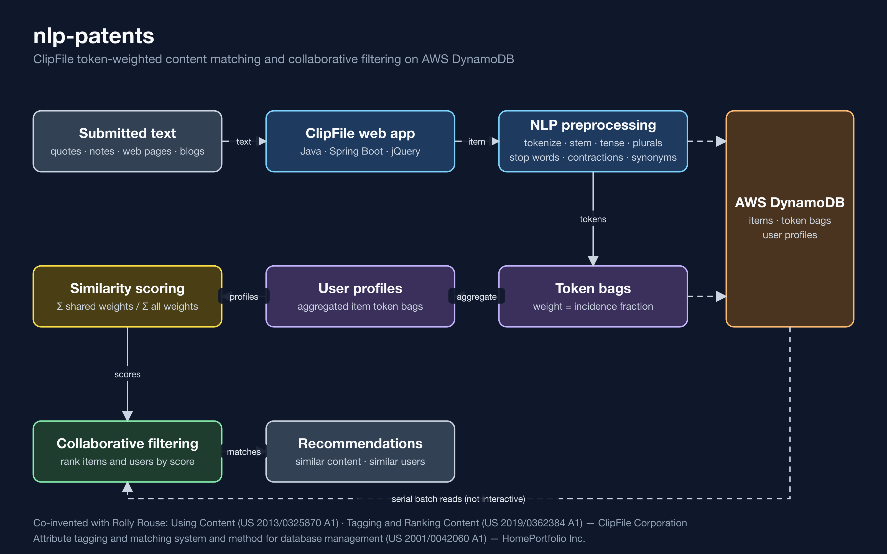

# nlp-patents

Text-matching and recommendation work co-invented by Shawn C. Becker with Rolly Rouse. It covers token-weighted content matching at ClipFile and attribute-weighted similarity search at HomePortfolio.

## Patent publications

| Title | Publication | Assignee | Google Patents |
|---|---|---|---|
| Using Content | US 2013/0325870 A1 (continuation: US 2022/0075812 A1) | ClipFile Corporation | [US20130325870A1](https://patents.google.com/patent/US20130325870A1/en) |
| Tagging and Ranking Content | US 2019/0362384 A1 (related: US 2014/0278986 A1) | ClipFile Corporation | [US20190362384A1](https://patents.google.com/patent/US20190362384A1/en) |
| Attribute tagging and matching system and method for database management | US 2001/0042060 A1 | HomePortfolio Inc. | [US20010042060A1](https://patents.google.com/patent/US20010042060A1/en) |

### Using Content

Software tools let people clip text, images, and video from any platform into a shared, host-controlled store. Users form meshes of tags that capture their mindset about each item. Primary tags record direct observations about the content. Secondary tags record observations about other tags. Tag meshes can be shared, with permission, to help others understand those mindsets and to produce, deliver, and use content.

### Tagging and Ranking Content

Content items are ranked from the tags and tag relationships that users attach to them. A tag's rank combines an importance score and an association score, weighted by context. Tag ranks are used to find patterns and clusters of related tags. They also drive personal and group preference views.

### Attribute tagging and matching system and method for database management

An attribute language lets products be searched by overall similarity across weighted attribute values. "Relevance" weightings refine product-to-product similarity. "Must match" checkboxes, combined with "importance" weightings on any attribute, let users tune their search results.

## ClipFile NLP pipeline (Java, AWS DynamoDB)

This pipeline predates modern embedding-based NLP. Users submitted text, such as quotes, personal notes, web pages, and blogs, to ClipFile's content-management system. Each item was then preprocessed as follows:

- tokenization and stemming
- tense removal and singularization
- stop-word removal
- contraction handling
- synonym replacement

Each content item became a bag of weighted tokens. Each token's weight was its incidence fraction within the item's token set. A user's profile was the aggregate of their items' token bags.

The similarity between two token sets was the sum of their overlapping weighted tokens divided by the sum of all weighted tokens in both sets. These scores drove collaborative filtering, which surfaced similar content items and users with similar profiles.

Matching ran serially against AWS DynamoDB, so it was not interactive. Today, the same scoring maps naturally to vector operations on GPUs.
